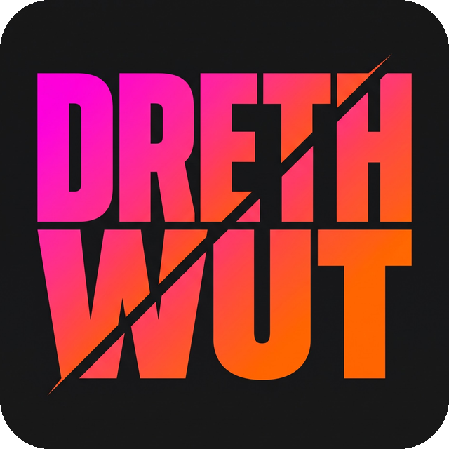
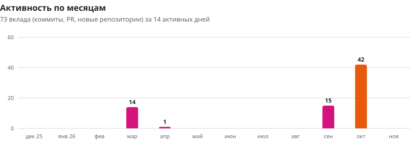
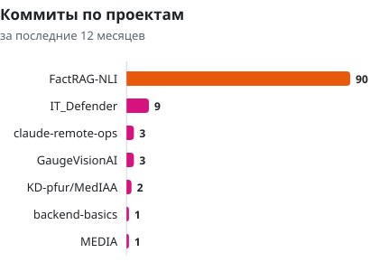
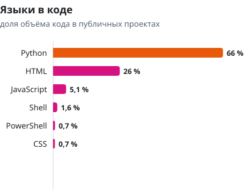
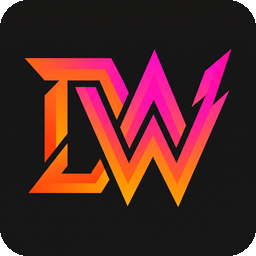

<div align="center">



# Drethwut | Egor

**Python-разработчик: компьютерное зрение, локальные LLM и RAG, backend на FastAPI**

Делаю ИИ-системы, обучаю нейросети, работаю с базами данных и участвую в хакатонах.


</div>

## Чем я занимаюсь

Большинство ИИ-сервисов работают по одной схеме: данные уходят в облако, ответ возвращается обратно. Для завода, больницы или внутренней документации компании так нельзя: данные не должны покидать контур, а ошибка модели стоит дорого. Поэтому мои проекты построены на трёх правилах.

1. **Данные остаются на месте.** Модели работают на обычной видеокарте ноутбука (RTX 5060, 8 ГБ), без внешних API и без отправки данных наружу.
2. **Модель проверяют, а не принимают на веру.** Ответ языковой модели сверяется с источником, показания прибора сглаживаются и отбрасываются при низкой уверенности.
3. **Цифры с условиями.** В README каждого проекта указано, на каких данных и на каком железе получена метрика, и где система ошибается.

Сейчас дополнительно прохожу курс X5 Tech по веб-разработке на Python: REST и OpenAPI, asyncio, интеграции с внешними сервисами.

## Проекты

### [GaugeVision AI](https://github.com/EGRNEGR/GaugeVisionAI): камеры вместо обходчика на ТЭЦ

На теплоэлектростанциях до 60 % приборов (оценка команды) не подключены к системе управления: манометр показывает давление, но передать его на пульт не может. Показания раз в смену переписывает обходчик, и всё, что случилось между обходами, остаётся незамеченным. Поставить «умный» датчик дорого: нужны кабели, проект и остановка котла.

GaugeVision AI читает стрелочные приборы обычной камерой. Нейросеть YOLOv8n находит прибор в кадре, затем алгоритмы OpenCV выпрямляют циферблат, находят стрелку и переводят её угол в значение по калибровке. Результат приходит на пульт оператора с трендами, уставками и сигнализацией по ISA-18.2. Интернет для работы не нужен.

<a href="https://github.com/EGRNEGR/GaugeVisionAI">
  
</a>

| Что измерено | Результат | Условия |
|---|---|---|
| Ошибка показаний | 0,38 % шкалы макс., 0,11 % в среднем | 28 сцен стенда, наклон камеры до 41° |
| Скорость детектора | 7,2 мс на кадр | YOLOv8n, RTX 5060 Laptop, FP16 |
| Точность детектора | mAP₅₀ 90,1 % | валидация обучения |
| Масштаб | 25 камер, загрузка GPU 72 % | 4 кадра/с на камеру, один ноутбук |

Поддерживает 6 классов приборов и 17 единиц измерения, камеры RTSP, ONVIF, MJPEG, USB и смартфон по QR-коду.

**Стек:** Python, FastAPI (async), YOLOv8n, OpenCV, WebSocket, SQLite.

### [FactRAG-NLI](https://github.com/EGRNEGR/FactRAG-NLI): ответы по документации, которые проверяют сами себя

Языковая модель умеет уверенно выдумывать. В поиске по технической документации это опаснее молчания: неверный пункт стандарта выглядит так же убедительно, как верный.

FactRAG-NLI находит нужные фрагменты в PDF, DOCX, TXT и Markdown, даёт их модели Qwen2.5-14B и получает черновик ответа с цитатами. Затем вторая модель, mDeBERTa, разбирает черновик на отдельные утверждения и для каждого проверяет, следует ли оно из процитированного фрагмента. Неподтверждённое утверждение вырезается. Если подтверждённого почти не осталось, система честно отказывается отвечать.

```text
Вопрос → поиск: BGE-M3 + BM25 → RRF → реранкер → черновик Qwen2.5-14B → проверка mDeBERTa NLI → ответ с цитатами или отказ
```

Проверено на 220 вопросах по RFC, стандартам NIST и документации PostgreSQL. Сравнение с той же моделью без проверки:

| Метрика | Без проверки | С проверкой |
|---|---:|---:|
| Галлюцинации на вопросах с известным ответом | 10,8 % | **5,4 %** |
| Корректный исход по всем вопросам | 83,2 % | 78,6 % |
| Отказы на вопросах, где ответ есть | 7,9 % | 18,1 % |

Проверка вдвое снижает число выдуманных фактов и не добавляет ни одного нового. Цена - больше отказов там, где ответ в базе был: NLI-модель иногда не узнаёт верное утверждение. Проверка добавляет к запросу около 0,4 с, основное время (около 20 с) занимает генерация. Весь конвейер помещается на одну видеокарту с 8 ГБ.

**Стек:** Python, Qdrant, BM25, BGE-M3, llama.cpp, mDeBERTa, FastAPI, Streamlit, CUDA.

### [claude-remote-ops](https://github.com/EGRNEGR/claude-remote-ops): пульт для ИИ-агента в Telegram

Claude Code работает в терминале на компьютере, и стоит отойти от него, как контроль теряется: не видно, чем закончилась долгая задача, и нельзя остановить зависший процесс. Этот бот превращает Telegram в пульт управления. Задачу можно отправить с телефона текстом или голосом, бот запускает агента на ПК и раз в 3 секунды обновляет карточку статуса с его текущими действиями. В конце приходит ответ и архив изменённых файлов.

<a href="https://github.com/EGRNEGR/claude-remote-ops">
  
</a>

Голосовые распознаются локально через faster-whisper на видеокарте. Есть кнопка аварийной остановки всего дерева процессов, отчёты по прошлым сессиям, файловый менеджер и перезапуск бота с телефона. Перезапуск устроен так, что сломанное обновление не роняет бота. Ботом управляет только один владелец, а доступ к файлам ограничен разрешёнными папками.

**Стек:** Python, aiogram 3, faster-whisper, pydantic-settings, pytest, Windows CI.

### [AIPrivacy Sentinel](https://github.com/EGRNEGR/IT_Defender): защита данных в браузере

Люди вставляют в чаты с ИИ рабочие письма, ключи API и номера карт, не задумываясь, куда это уходит. Расширение для Chrome, Edge и Opera находит такие данные прямо в поле ввода и заменяет их заглушками ещё до отправки. Вторая функция - антифишинг: ссылка проверяется по VirusTotal, PhishTank, OpenPhish и AbuseIPDB, и вместо опасного сайта открывается страница с объяснением причины.

**Стек:** JavaScript, Chrome Extensions API (Manifest V3), HTML, CSS.

### [backend-basics](https://github.com/EGRNEGR/backend-basics): задания курса X5 Tech

Структура Python-проекта, CLI на внешних API с повторными попытками, контракт OpenAPI 3.1 для сервиса «Библиотека», асинхронный загрузчик на httpx и asyncio. Каждое задание сдано отдельным Pull Request с описанием и проверками.

**Стек:** Python, httpx, asyncio, OpenAPI 3.1, pytest, Ruff.

## Активность на GitHub

Графики собирает [скрипт](scripts/build_charts.py) из GitHub API, GitHub Actions обновляет их каждый день.

<picture>
  <source media="(prefers-color-scheme: dark)" srcset="assets/charts/activity-dark.svg">
  
</picture>

<p>
  <picture>
    <source media="(prefers-color-scheme: dark)" srcset="assets/charts/repos-dark.svg">
    
  </picture>
  <picture>
    <source media="(prefers-color-scheme: dark)" srcset="assets/charts/languages-dark.svg">
    
  </picture>
</p>

<!-- stats:start -->
<details>
<summary>Те же данные таблицей</summary>

| Показатель | Значение |
|---|---:|
| Вклады за год | 133 |
| Коммиты за год | 117 |
| Pull Request за год | 4 |
| Активные дни | 21 |

| Месяц | Вклады |
|---|---:|
| декабрь 2025 | 0 |
| январь 2026 | 0 |
| февраль 2026 | 0 |
| март 2026 | 14 |
| апрель 2026 | 1 |
| май 2026 | 0 |
| июнь 2026 | 0 |
| июль 2026 | 0 |
| август 2026 | 0 |
| сентябрь 2026 | 15 |
| октябрь 2026 | 67 |
| ноябрь 2026 | 35 |

| Репозиторий | Коммиты |
|---|---:|
| FactRAG-NLI | 88 |
| IT_Defender | 9 |
| claude-remote-ops | 3 |
| GaugeVisionAI | 3 |
| KD-pfur/MedIAA | 2 |
| backend-basics | 1 |
| MEDIA | 1 |

| Язык | Доля кода |
|---|---:|
| Python | 66 % |
| HTML | 26 % |
| JavaScript | 5,1 % |
| Shell | 1,6 % |
| PowerShell | 0,7 % |
| CSS | 0,7 % |

</details>
<!-- stats:end -->

## Технологии

| Область | Инструменты |
|---|---|
| Языки | Python, JavaScript, TypeScript, HTML/CSS |
| ML и компьютерное зрение | PyTorch, YOLOv8 (Ultralytics), OpenCV, CUDA |
| LLM и RAG | llama.cpp, Qwen, BGE-M3, BGE reranker, mDeBERTa NLI, Qdrant, BM25, faster-whisper |
| Backend | FastAPI, asyncio, httpx, aiogram, WebSocket, SQLite, OpenAPI |
| Интерфейсы | Streamlit, Telegram-боты, Chrome Extensions (MV3), HTML/JS-дашборды |
| Качество | pytest, Ruff, mypy, GitHub Actions, e2e- и браузерные тесты, оценка RAG |

## Все репозитории

| Репозиторий | Что это | Статус |
|---|---|---|
| [GaugeVisionAI](https://github.com/EGRNEGR/GaugeVisionAI) | Считывание стрелочных приборов ТЭЦ камерами | активная разработка |
| [FactRAG-NLI](https://github.com/EGRNEGR/FactRAG-NLI) | Локальный RAG с проверкой каждого утверждения | рабочая версия |
| [claude-remote-ops](https://github.com/EGRNEGR/claude-remote-ops) | Telegram-пульт для Claude Code | рабочая версия |
| [IT_Defender](https://github.com/EGRNEGR/IT_Defender) | Браузерное расширение AIPrivacy Sentinel | прототип |
| [backend-basics](https://github.com/EGRNEGR/backend-basics) | Задания курса X5 Tech по Python | обновляется |
| [KD-pfur/MedIAA](https://github.com/KD-pfur/MedIAA) | MedFlow: разбор медицинских документов с OCR, командный проект | MVP |
| [MEDIA](https://github.com/EGRNEGR/MEDIA) | Идея проекта на стыке медицины и ИИ | заготовка |

## Связаться

Нашли ошибку или есть идея по проекту - открывайте Issue в нужном репозитории, я их читаю. Если проект пригодился, поставьте звезду: так я понимаю, что стоит развивать дальше.

<div align="center">
  
</div>
